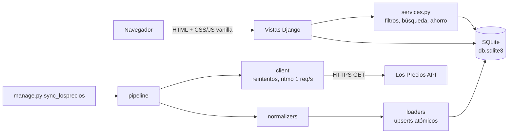

# Auditoría integral de PriceWise

Fecha: 30 de octubre de 2026 · Rama: `audit/comprehensive-improvements` (desde `develop` en `0463973`)

## Resumen ejecutivo

PriceWise funcionaba y tenía una base sana: 60 tests en verde, autorización por dueño correcta en listas, reseñas y favoritos, CSRF en todos los formularios POST y ningún secreto en el repositorio ni en su historial. La auditoría encontró **77 hallazgos**. Los más graves eran de configuración (clave secreta y `DEBUG` fijos en el código, sin perfil de producción), dependencias con vulnerabilidades conocidas (Pillow 12.3.0 con 39 avisos), errores que el usuario veía (JavaScript roto para visitantes, filtros del catálogo que se borraban entre sí, header que tapaba productos en el celular, filtros inexistentes en el celular) y un N+1 que hacía 27 consultas por página del catálogo.

Se resolvieron 60, quedaron 5 parciales, 8 pendientes y 4 no abordables por decisión del equipo o del curso. Todos los de severidad alta y media quedaron resueltos. Los tests pasaron de 60 a 129, todos en verde.

| Severidad | Total | Resueltos | Parciales | Pendientes | No abordables |
|---|---|---|---|---|---|
| Alta | 7 | 7 | 0 | 0 | 0 |
| Media | 21 | 21 | 0 | 0 | 0 |
| Baja | 49 | 32 | 5 | 8 | 4 |
| **Total** | **77** | **60** | **5** | **8** | **4** |

| Categoría | Hallazgos |
|---|---|
| Seguridad y dependencias (SEC) | 11 |
| Errores funcionales (FUN) | 12 |
| Datos y persistencia (DAT) | 5 |
| Integración Los Precios (INT) | 6 |
| Rendimiento (PER) | 6 |
| Responsive (RES) | 6 |
| Accesibilidad (A11Y) | 12 |
| UX y copy (UX) | 6 |
| Calidad de código (COD) | 8 |
| Testing (TST) | 3 |
| Documentación (DOC) | 2 |

## Arquitectura encontrada

- **Django 6.0** con plantillas del servidor, sin framework de frontend. JS vanilla para el panel de listas, los diálogos de compartir/borrar y el menú de agregar a lista; GSAP desde CDN con SRI para animaciones, respetando `prefers-reduced-motion`.
- **Apps:** `products` (catálogo, precios, reseñas, favoritos, supermercados, integración), `shopping_lists` (listas, recomendación del supermercado más barato, gasto por categoría), `accounts` (registro, login, cambio de contraseña) y `pricewise` (settings, plantillas base, filtro `money`).
- **Integración:** `products/integrations/lospreciosco/` separa cliente HTTP, normalización, carga y orquestación. Se ejecuta a mano con `manage.py sync_losprecios`.
- **Datos:** SQLite versionada en el repo por decisión del curso (5.043 productos, 6.540 precios, 6.790 filas de historial al momento de la auditoría).
- **Infraestructura:** sin despliegue. Solo había un workflow de CodeQL hacia `main`.

## Tecnologías y dependencias

| Paquete | Antes | Después | Motivo |
|---|---|---|---|
| Django | 6.0.7 | 6.0.8 | 3 avisos de GeoDjango (no alcanzables: el proyecto no usa `django.contrib.gis`); parche de la misma versión menor, sin riesgo |
| Pillow | 12.3.0 | 13.0.0 | 39 avisos en decoders de imagen; alcanzables al subir imágenes por el admin (`ImageField`) |
| requests | sin versión | 2.34.2 | fijar la versión instalada |

Con las versiones nuevas, `pip-audit` no reporta vulnerabilidades y la suite completa pasa (ver `TEST_REPORT.md`).

## Alcance real de la inspección

- **Código:** todos los archivos Python (2.413 líneas sin migraciones), las 18 plantillas, los 17 CSS y los 5 JS; settings, `requirements.txt`, `.gitignore`, workflow de CodeQL y README.
- **Ejecución:** tests, `check --deploy`, `makemigrations --check`, `pip-audit`, medición de consultas con `CaptureQueriesContext` sobre la base real, pruebas de entradas límite contra el servidor.
- **Navegador:** la app real en `localhost:8765`, con y sin sesión, en 375, 768, 1024, 1280 y 1920 px. Catálogo y filtros, detalle, comparación, favoritos, supermercados, detalle de lista con compartir y borrar, crear lista, login y 404. Teclado en el panel de listas y en el diálogo.
- **No cubierto:** Safari y Firefox (solo Chromium), lectores de pantalla reales (se verificaron nombres accesibles, roles y foco, no la lectura con VoiceOver o NVDA), plantillas del admin de Django, carga bajo concurrencia.

## Inventario de hallazgos

Tipo: **D** defecto confirmado · **R** riesgo potencial · **T** deuda técnica · **O** oportunidad de mejora · **L** limitación externa.
Prioridad: P0 obligatorio · P1 obligatorio si no compromete P0 · P2 si hay tiempo.

### Seguridad y dependencias

| ID | Tipo | Ubicación | Problema e impacto | Evidencia | Sev. | Prio. | Solución | Estado |
|---|---|---|---|---|---|---|---|---|
| SEC-01 | D | `pricewise/settings.py:23` | `SECRET_KEY` fija en el código con prefijo `django-insecure`; cualquier despliegue la heredaría | código, `check --deploy` W009 | Alta | P0 | Leer de `DJANGO_SECRET_KEY`; en producción exigir ≥50 caracteres y no insegura | Resuelto |
| SEC-02 | D | `settings.py:26-28` | `DEBUG = True` y `ALLOWED_HOSTS = []` sin forma de cambiarlos; un despliegue mostraría trazas internas | código, W018, W020 | Alta | P0 | Perfil `DJANGO_ENV`; producción exige `DEBUG=false` explícito y hosts sin `*` | Resuelto |
| SEC-03 | D | `settings.py` | Sin cookies seguras, HSTS ni redirección a HTTPS | W004, W008, W012, W016 | Media | P0 | Activarlos solo en producción; proxy SSL opcional | Resuelto (W005 y W021 aceptados, ver Riesgos) |
| SEC-04 | D | `products/services.py:8` | `?min_price=NaN` o `Infinity` producía un error 500 | probado contra el servidor | Media | P0 | `parse_price` rechaza no finitos y negativos | Resuelto |
| SEC-05 | D | `products/views.py:94` | Redirección al `Referer` sin validar (open redirect) | código | Baja | P0 | `url_has_allowed_host_and_scheme`, como ya hacía `accounts` | Resuelto |
| SEC-06 | R | `accounts/views.py:26` | Login sin límite de intentos | código | Baja | P2 | `django-axes` u otro limitador al desplegar | Pendiente (requiere dependencia) |
| SEC-07 | R | `accounts/forms.py:26` | Email único solo en el formulario, no en la base | código | Baja | P2 | Restricción única en un modelo de perfil | Pendiente |
| SEC-08 | R | `loaders.py:72` | `image_url` de la API se guarda sin validar; termina en `` con autoescape | código | Baja | P2 | `URLValidator` antes de guardar | Pendiente (autoescape mitiga XSS) |
| SEC-09 | D | `requirements.txt` | Pillow 12.3.0 con 39 avisos; Django 6.0.7 con 3 (GIS) | `pip-audit` | Alta | P0 | Pillow 13.0.0, Django 6.0.8 | Resuelto |
| SEC-10 | O | `settings.py` | Cabeceras `nosniff`, `Referrer-Policy` y `X-Frame-Options` implícitas | código | Baja | P1 | Declararlas explícitamente (`DENY`, `same-origin`) | Resuelto |
| SEC-11 | T | `requirements.txt:3` | `requests` sin versión fija | código | Baja | P1 | `requests==2.34.2` | Resuelto |

### Errores funcionales

| ID | Tipo | Ubicación | Problema e impacto | Evidencia | Sev. | Prio. | Solución | Estado |
|---|---|---|---|---|---|---|---|---|
| FUN-01 | D | `shopping-list-panel.js:21` | `TypeError` en cada página para visitantes sin sesión; `?open_lists=true` abría un panel imposible de cerrar | consola del navegador | Alta | P0 | Comprobaciones de nulo; listeners opcionales | Resuelto y verificado |
| FUN-02 | D | `products/index.html:16-27`, `header.html` | Elegir orden borraba la categoría y viceversa; "Aplicar" borraba ambos; buscar borraba el orden | código y prueba | Alta | P0 | Campos ocultos para `category` y `sort`; el botón pulsado gana por ir último | Resuelto y verificado |
| FUN-03 | D | `shopping_lists/form.html:36` | Errores de cantidad y de fila no se mostraban; el formulario fallaba en silencio | código, test | Media | P0 | Mostrar `quantity.errors` y `non_field_errors` | Resuelto |
| FUN-04 | D | `products/views.py` (reseñas) | Una calificación inválida se ignoraba sin aviso | código, test | Baja | P0 | Mensaje de error; mensaje de confirmación al guardar | Resuelto |
| FUN-05 | D | `display-share-card.js:36` | "¡Copiado!" aparecía aunque el portapapeles fallara | código | Baja | P0 | `await` con manejo de error y estado anunciado | Resuelto |
| FUN-06 | D | `display-*.js` | Si fallaba la carga de la tarjeta, el botón no hacía nada | código | Baja | P0 | Tarjeta de error en el diálogo | Resuelto |
| FUN-07 | D | `shopping_lists/detail.html:31` | Sin JavaScript no había forma de borrar ni compartir una lista | código | Media | P0 | Enlaces reales; la vista devuelve página completa si no es fetch | Resuelto |
| FUN-08 | D | fragmentos de listas | Abrir `/share/` o `/delete/` directo mostraba HTML sin estilos | navegador | Baja | P1 | `card_page.html` sobre la base | Resuelto (el fragmento `/lists/` sigue sin base, ver COD) |
| FUN-09 | D | `category-chart.css:68`, `header.css`, `body.css` | Variable mal escrita (`--secundary`) y 4 declaraciones inválidas | código | Baja | P0 | Corregidas o eliminadas | Resuelto |
| FUN-10 | D | `_reviews.html:34` | "Borrar mi reseña" borraba sin confirmar | código | Media | P1 | Confirmación con `data-confirm` | Resuelto |
| FUN-11 | D | `toggle_favorite` | Marcar favorito recargaba y llevaba al inicio de la página | navegador | Baja | P1 | Vuelve a `#product-<id>` | Resuelto |
| FUN-12 | O | `header.html` | El visitante sin sesión no veía el enlace a Supermercados, que es público | código | Baja | P1 | Enlace también para visitantes | Resuelto |

### Datos y persistencia

| ID | Tipo | Ubicación | Problema e impacto | Evidencia | Sev. | Prio. | Solución | Estado |
|---|---|---|---|---|---|---|---|---|
| DAT-01 | R | `products/models.py:62` | `Category` con `CASCADE`: un clic en el admin borraba cientos de productos con sus precios, historial y reseñas | código; `remove_demo_data` solo borra categorías vacías y los loaders nunca borran | Media | P0 | `PROTECT`; migración probada en copia | Resuelto |
| DAT-02 | R | `models.py:164,189` | Calificación 1–5 solo validada por `choices`, no por la base | código | Baja | P0 | `CheckConstraint` en ambas reseñas | Resuelto |
| DAT-03 | D | `models.py:107` | El help text de `price_date` decía "campo Fecha de la API", pero se guarda la fecha local de la sincronización | `loaders.py:54` | Baja | P1 | Help text corregido | Resuelto |
| DAT-04 | L | repo | `db.sqlite3` versionada; `.gitignore` tiene `.sqlite3` (patrón que no coincide) | decisión del curso, README | Baja | — | Decisión del equipo | No abordable |
| DAT-05 | R | `loaders.py:96` | Si se edita un precio en el admin y la API trae el mismo valor del último historial, el precio editado no se corrige | código | Baja | P2 | Comparar contra `price.amount` | Pendiente |

### Integración Los Precios

| ID | Tipo | Ubicación | Problema e impacto | Evidencia | Sev. | Prio. | Solución | Estado |
|---|---|---|---|---|---|---|---|---|
| INT-01 | R | `loaders.py:24-40` | Un nombre de supermercado repetido con otro `api_id` lanzaba `IntegrityError` y abortaba toda la importación | código, test | Media | P0 | Savepoint por supermercado; se registra y se salta | Resuelto |
| INT-02 | D | `client.py:24,56` | Se reintentaba cualquier error, incluidos 401 y 404; se ignoraba `Retry-After` | código | Baja | P0 | Reintentar solo red, timeout, 429 y 5xx; `Retry-After` hasta 30 s | Resuelto |
| INT-03 | R | `pipeline.py:42` | Sin tope de páginas: una API defectuosa podía hacer girar el bucle sin fin | código | Baja | P0 | Tope de 200 páginas; se reporta como incompleta | Resuelto |
| INT-04 | D | `settings.py` | Sin `LOGGING`: el resumen INFO de la importación nunca se veía | código | Baja | P1 | Logger `products` a consola | Resuelto |
| INT-05 | T | `lospreciosco/` | Sin `__init__.py` (paquete de espacio de nombres, distinto a su carpeta padre) | código | Baja | P2 | Archivo agregado | Resuelto |
| INT-06 | T | `client.py:87` | `get_supermarkets_details` es un alias de otro método | código | Baja | P2 | Se conserva: lo usan el pipeline, los tests y el FakeClient | No abordado (documentado) |

### Rendimiento

| ID | Tipo | Ubicación | Problema e impacto | Evidencia | Sev. | Prio. | Solución | Estado |
|---|---|---|---|---|---|---|---|---|
| PER-01 | D | `_product_card.html:39` | Una consulta por tarjeta: 27 consultas por página | `CaptureQueriesContext` | Media | P1 | `Prefetch` de precios; `get_cheapest_price` los usa si existen | Resuelto: 27 → 4 |
| PER-02 | D | favoritos | Mismo N+1 en favoritos | medición | Media | P1 | Misma precarga | Resuelto: 16 → 5 (12 favoritos) |
| PER-03 | D | detalle de lista | Una consulta por producto de la lista | medición | Baja | P1 | `select_related('product')` | Resuelto: 10 → 7 (3 ítems) |
| PER-04 | O | logo | Logo PNG de 3008 px y 61 KB mostrado a 50 px de alto | `sips` | Baja | P1 | Reducido a 640 px, 22 KB | Resuelto |
| PER-05 | O | `base.html:12` | Google Fonts carga todo el eje 100–1000 de DM Sans más itálicas | código | Baja | P2 | Pedir solo los pesos usados | Pendiente |
| PER-06 | R | estáticos | Los estáticos no llevan hash: tras un cambio de CSS el navegador puede mostrar la versión vieja (pasó durante esta auditoría) | navegador | Baja | P2 | `ManifestStaticFilesStorage` al desplegar con `collectstatic` | Pendiente (depende del despliegue) |

### Responsive

| ID | Tipo | Ubicación | Problema e impacto | Evidencia | Sev. | Prio. | Solución | Estado |
|---|---|---|---|---|---|---|---|---|
| RES-01 | D | `base.css`, `header.css` | A 375 px el header fijo medía 221 px y el cuerpo dejaba 180: tapaba los primeros productos | medición en navegador | Alta | P1 | Header `sticky` en el celular | Resuelto y verificado |
| RES-02 | D | `body.css:257` | Bajo 900 px los filtros, el orden y el rango de precio desaparecían sin alternativa | navegador | Alta | P1 | Panel plegable sobre los productos; categorías como chips | Resuelto y verificado |
| RES-03 | D | `body.css:47` | Grilla fija de 4 columnas: a 1024 px tarjetas de 106 px, nombres partidos letra por letra e iconos encimados | captura | Media | P1 | `auto-fill` con mínimo `clamp(180px, 15vw, 260px)` | Resuelto: 1024 px 3×202, 1920 px 5×280 |
| RES-04 | D | `list_panel.css:11` | Panel de listas de 450 px fijo, más ancho que un celular | medición | Media | P1 | `min(450px, 100vw)` | Resuelto |
| RES-05 | D | `base.css`, `header.css` | Margen por defecto del `body` y buscador que desbordaba el header en el celular | medición | Baja | P1 | `margin: 0`; `min-width: 0` en el campo | Resuelto |
| RES-06 | R | `header.css` | Se estimó desborde del header entre 900 y 1400 px con sesión | medición: no se reproduce, cabe en 90 px | Baja | P2 | Ajuste preventivo de espaciado; saludo oculto ≤1360 px | Resuelto (preventivo) |

### Accesibilidad (WCAG 2.2 AA)

| ID | Tipo | Ubicación | Problema e impacto | Evidencia | Sev. | Prio. | Solución | Estado |
|---|---|---|---|---|---|---|---|---|
| A11Y-01 | D | `base.html` | Sin enlace para saltar al contenido | código | Media | P1 | Skip link visible al enfocar | Resuelto |
| A11Y-02 | D | `header.html` | Enlaces del header fuera de un `<nav>` | código | Baja | P1 | `<nav aria-label>` | Resuelto |
| A11Y-03 | D | catálogo y fragmentos | El catálogo no tenía `<h1>`; el panel y las tarjetas inyectaban un segundo `<h1>` | código | Media | P1 | `<h1>` oculto visualmente; fragmentos con `<h2>` | Resuelto |
| A11Y-04 | D | panel de listas | No era diálogo, sin `aria-expanded`, foco sin mover, sin Escape; sus enlaces ocultos se alcanzaban con Tab | código | Media | P1 | `inert` cerrado, foco al abrir y al cerrar, Escape | Resuelto y verificado con teclado |
| A11Y-05 | D | detalle de lista | Overlay sin `role="dialog"`, sin trampa de foco ni Escape | código | Media | P1 | `<dialog>` nativo con `showModal()` | Resuelto y verificado con teclado |
| A11Y-06 | D | `_product_card.html` | `role="menu"` sin comportamiento de menú | código | Media | P1 | Quitar los roles; el `
` nativo basta | Resuelto |
| A11Y-07 | D | `_product_card.html`, `body.css` | Favorito sin `aria-pressed`, con 26 px de alto | código | Media | P1 | `aria-pressed`; área de 44 px | Resuelto |
| A11Y-08 | D | `body.css`, `list_panel.css` | Contraste: botones de filtro 4,04:1; X del panel 1,98:1 | cálculo | Media | P1 | Token `--secondary-text-color` | Resuelto: 4,81:1 y 5,18:1 |
| A11Y-09 | D | plantillas | Imágenes sin `width`/`height`; `alt` repetía el nombre visible | escaneo | Baja | P1 | Dimensiones; `alt=""` en la foto de la tarjeta | Resuelto |
| A11Y-10 | D | `_reviews.html:15` | Estrellas en orden DOM 5→1: flechas y lector de pantalla van al revés | código | Baja | P2 | Orden 1→5 con selector `:has()` | Pendiente |
| A11Y-11 | D | registro y contraseña | Ayudas sin `aria-describedby` | código | Baja | P2 | Ids y `aria-describedby` en los widgets | Parcial (pendiente) |
| A11Y-12 | O | `base.css:256` | Encabezados de tabla a 10 px | código | Baja | P2 | Mínimo 11–12 px | Parcial (filtros ya pasaron de 10 a 11 px) |

### UX y copy

| ID | Tipo | Ubicación | Problema e impacto | Evidencia | Sev. | Prio. | Solución | Estado |
|---|---|---|---|---|---|---|---|---|
| UX-01 | O | `header.html` | El selector "Producto/Supermercado" parecía buscar tiendas, pero filtra productos por tienda | revisión | Baja | P1 | "Por producto / Por supermercado" y ejemplo en el placeholder | Resuelto |
| UX-02 | D | `supermarkets/index.html:35` | "Catálogo no disponible en API" es jerga técnica; estilo inline | código | Baja | P1 | "Aún no tenemos precios de este supermercado." | Resuelto |
| UX-03 | D | `base.html:28` | Advertencias e info se veían como éxito | código | Baja | P1 | Clase por `level_tag` | Resuelto |
| UX-04 | D | plantillas | Sin páginas 404 ni 500 propias | código | Media | P1 | `404.html` sobre la base; `500.html` autónoma | Resuelto |
| UX-05 | D | `body.css:421` | `transition: all` | escaneo | Baja | P2 | Propiedades explícitas | Resuelto |
| UX-06 | D | `body.css:206` | El hover de los filtros agregaba un borde lateral y hacía saltar el texto | código | Baja | P1 | Cambio de fondo y color, sin borde | Resuelto |

### Calidad de código

| ID | Tipo | Ubicación | Problema e impacto | Evidencia | Sev. | Prio. | Solución | Estado |
|---|---|---|---|---|---|---|---|---|
| COD-01 | D | `products/admin.py:52,57` | Dos clases `ReviewAdmin`; la segunda tapaba a la primera | código | Baja | P2 | `ProductReviewAdmin` y `SupermarketReviewAdmin` | Resuelto |
| COD-02 | T | `views.py` de products y listas | `from .services import *` | código | Baja | P2 | Importaciones explícitas | Resuelto |
| COD-03 | T | `products/views.py` | Vistas de reseña de producto y supermercado copiadas | código | Baja | P2 | Helper `save_review` | Resuelto |
| COD-04 | T | `form.html`, `base.html` | Scripts inline | código | Baja | P2 | `list-form.js`; `card-dialog.js` | Parcial (queda `shoppingListsUrl` inline en `base.html`) |
| COD-05 | T | varios CSS | Colores fijos pese a que `base.css` dice que los tokens son la única fuente | código | Baja | P2 | Tokens | Parcial (corregidos los tocados; quedan `#1f1f1f`, `#156b2e` y otros) |
| COD-06 | T | varios CSS | Selectores muertos y reglas duplicadas | código | Baja | P2 | Limpieza | Parcial (`.supermarket-button p` y declaraciones basura eliminadas) |
| COD-07 | T | `products/urls.py:17`, `pricewise/urls.py` | `supermarkets/<pk>` sin barra final; índice en `/` y `/products/` | código | Baja | — | Cambiar rutas públicas sin beneficio funcional | No abordable (documentado) |
| COD-08 | T | GitHub | ~45 ramas remotas ya integradas | `git branch -a` | Baja | — | Limpieza destructiva, la decide el equipo | No abordable |

### Testing y documentación

| ID | Tipo | Ubicación | Problema e impacto | Evidencia | Sev. | Prio. | Solución | Estado |
|---|---|---|---|---|---|---|---|---|
| TST-01 | D | `.github/workflows` | Ningún workflow corría los tests; los PR a `develop` no tenían checks | repo | Media | P1 | `tests.yml` en push y PR a `main` y `develop` | Resuelto |
| TST-02 | D | tests | Sin tests para favoritos, reseñas de supermercado, autorización negativa, cliente HTTP, settings | mapa de URLs vs tests | Media | P1 | 69 tests nuevos | Resuelto (logout y envío de registro siguen sin test) |
| TST-03 | O | entorno | `coverage` no instalado | `python -m coverage` | Baja | P2 | Agregar al CI | Pendiente |
| DOC-01 | D | `README.md` | Rutas de supermercados incorrectas; sin variables de entorno ni cómo correr tests | código | Baja | P1 | README actualizado | Resuelto |
| DOC-02 | O | repo | Sin documentación de arquitectura ni auditoría | repo | Baja | P1 | Este documento y sus anexos | Resuelto |

## Riesgos que quedan

- **HSTS en subdominios y preload (W005, W021):** desactivados a propósito. Ambos son difíciles de deshacer si algún subdominio no tiene HTTPS. Se activan con `DJANGO_SECURE_HSTS_INCLUDE_SUBDOMAINS=true` y fijando `SECURE_HSTS_PRELOAD` cuando el dominio real esté probado.
- **Clave de desarrollo en el código:** sigue en `settings.py` y en el historial, solo como valor de desarrollo. Producción la rechaza. Cualquier despliegue debe generar una clave nueva.
- **Base de datos versionada:** la migración `0013` no está en la `db.sqlite3` del repo; cada integrante debe correr `python manage.py migrate`. Cada sincronización cambia el archivo y facilita conflictos de merge.
- **Caché de estáticos:** sin hash en los nombres, un navegador puede mostrar CSS viejo después de un cambio (PER-06).
- **Header en pantallas medianas:** entre 900 y 1360 px el saludo "Hola, usuario" se oculta para que el menú quepa en una línea.

## Skills y herramientas

| Skill o herramienta | ¿Disponible? | ¿Consultada? | ¿Usada? | Aplicación concreta | Resultado verificado |
|---|---|---|---|---|---|
| `agent-skills:security-and-hardening` | Sí | Sí | Sí | Modelo de amenazas de settings, entradas y redirecciones; secretos solo por entorno | `check --deploy` de 7 a 2 avisos aceptados; tests de producción |
| `agent-skills:performance-optimization` | Sí | Sí | Sí | Medir antes y después con el mismo script, 5 corridas, mediana | 27 → 4 consultas; `assertNumQueries(4)` |
| `impeccable:impeccable` | Sí | Sí (`context`, `craft-floor`) | Sí | Piso de calidad: contraste, estados, sin bordes laterales de color; detector sobre los archivos tocados | 0 hallazgos del detector (no resuelve `` en plantillas) |
| `anthropic-skills:web-design-guidelines` | Sí | Sí (reglas descargadas de vercel-labs) | Sí | Escaneo de `transition: all`, imágenes sin dimensiones, `inputmode`, foco, confirmación de acciones destructivas | Hallazgos A11Y-09, UX-05, FUN-10 resueltos |
| `ui-ux-pro-max:ui-ux-pro-max` | Sí | Sí (búsquedas `ux`) | Sí | Chips que se reacomodan para filtros; tamaño de objetivos táctiles (WCAG 2.2: 24 px mínimo) | Categorías como chips en el celular; objetivos de 44 px |
| `taste-skill:taste-skill` | Sí | Sí | Parcial | La skill declara fuera de alcance la UI de producto; se aplicaron solo sus chequeos transversales (contraste de botones, radios, sin guiones largos en el copy) | Sin cambios de identidad visual |
| `agent-skills:frontend-ui-engineering` | Sí | Sí | Sí | Foco en diálogos, estados vacíos y de error, jerarquía de encabezados | Diálogo y panel probados con teclado |
| Frontend-Design | No (no figura en el catálogo de esta sesión) | — | — | Sustituida por `frontend-ui-engineering` + `impeccable` | — |
| Navegador integrado | Sí | — | Sí | Mediciones en 5 anchos, consola, teclado | Ver `TEST_REPORT.md` |
| `pip-audit` (venv temporal) | Instalado para la auditoría | — | Sí | Dependencias directas y transitivas | 42 avisos antes, 0 después |
| Codex (`codex-companion review`) | Sí | — | Sí | Revisión final del diff contra `develop` | Sin problemas bloqueantes; 1 observación aplicada |

## Recomendaciones

1. Antes de desplegar: generar la clave, definir `DJANGO_ENV=production` y las variables del README, y activar `ManifestStaticFilesStorage`.
2. Agregar un limitador de intentos al login (SEC-06) cuando se despliegue.
3. Resolver los pendientes de accesibilidad A11Y-10 y A11Y-11 (pequeños, sin riesgo).
4. Decidir en equipo si la base de datos sigue en el repo; si sigue, migrarla una vez y commitearla junto con `0013`.
5. Limpiar las ramas remotas ya integradas (COD-08).

## Limitaciones de la auditoría

- Solo se probó en Chromium. Sin Safari, Firefox ni dispositivos reales.
- No se usó un lector de pantalla real.
- La página 404 propia solo se ve con `DEBUG` apagado; se verificó con test, no en el navegador (el servidor de desarrollo corre con `DEBUG` encendido).
- `coverage` no está instalado, así que no hay porcentaje de cobertura.
- La integración con Los Precios se probó con un cliente falso; no se hizo una sincronización real nueva para no gastar la cuota de la API.
- El workflow de CI se escribió pero aún no ha corrido en GitHub (corre al abrir el PR).
